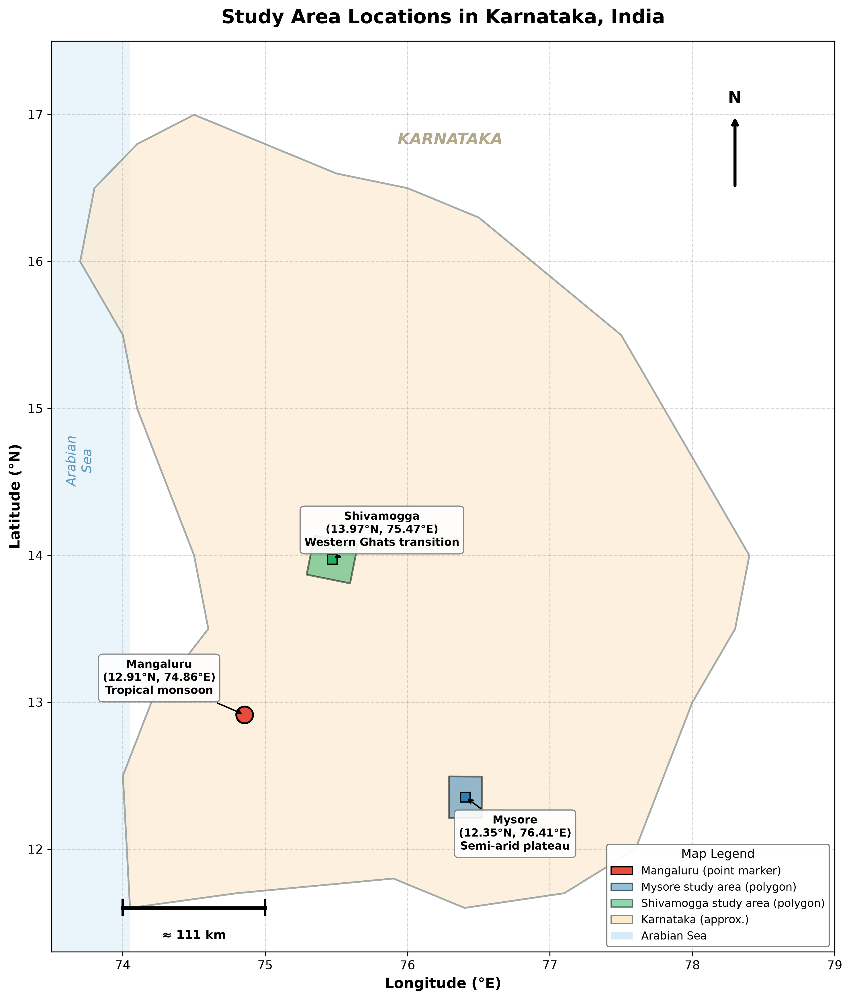
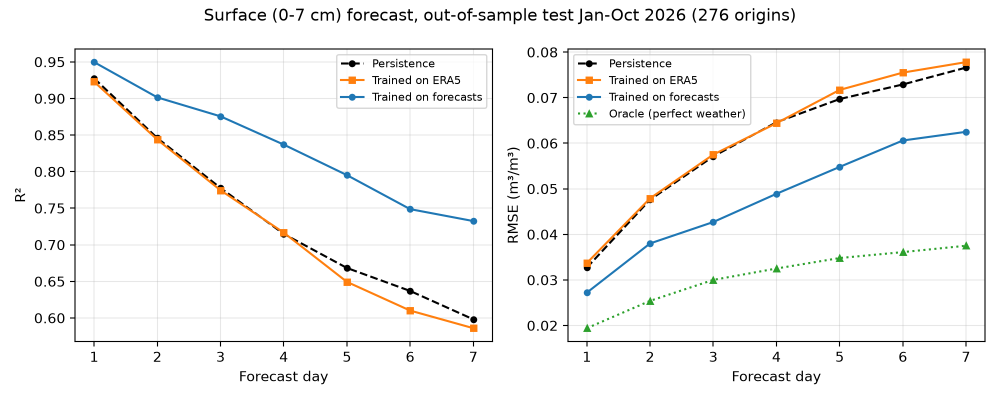
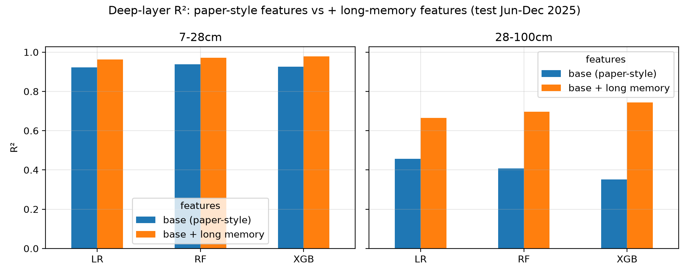
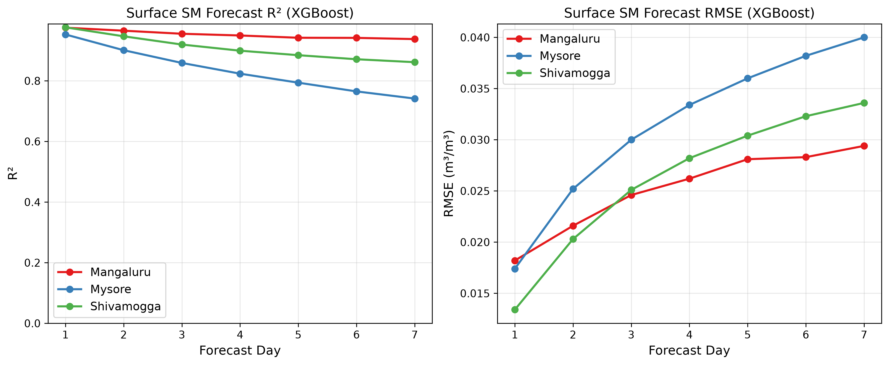
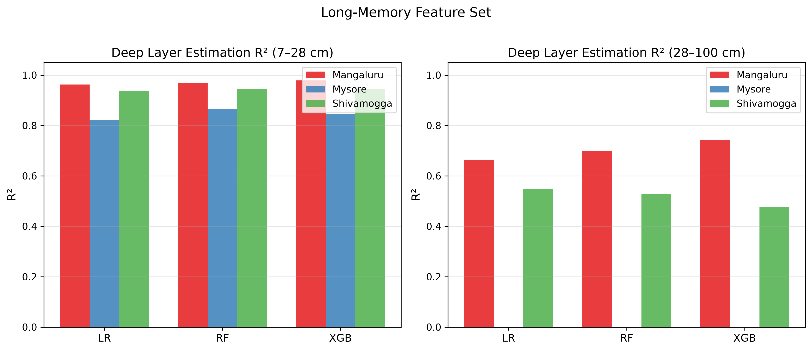
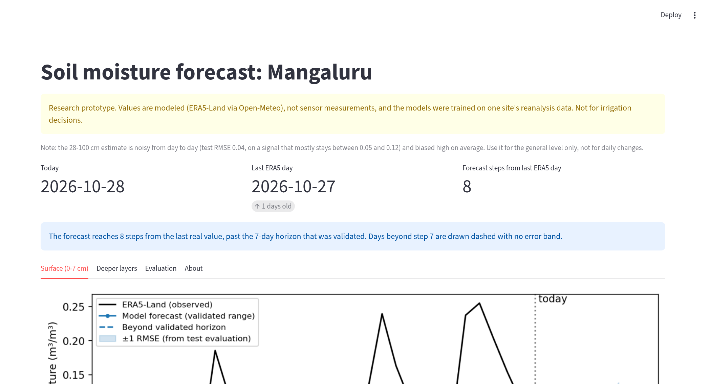

# 🌾 Machine Learning-Powered Soil Moisture Forecasting & Root-Zone Retrieval

[](https://www.python.org/)
[](https://xgboost.readthedocs.io/)
[](https://streamlit.io/)
[-green.svg)](https://doi.org/10.1016/j.atech.2026.100XXX)
[](#-study-regions--climatic-diversity)

> **A practical, sensor-free hydrological forecasting pipeline adapted for tropical and semi-arid agro-climatic zones in Karnataka, India.**
> 
> *Developed as an academic Mini Project in the Department of Civil Engineering, National Institute of Technology Karnataka (NITK), Surathkal, under the guidance of Dr. Shweta H. R.*

---

## 📌 Executive Summary

Soil moisture dictates whether crops thrive, when farmers should irrigate, and how floodwaters move across watersheds. However, measuring it is notoriously difficult:
- **In-situ probes** (e.g., TDR sensors) are expensive, fragile, and only give point measurements.
- **Satellites** (optical and radar) only skim the top ~5 cm and often struggle with thick monsoon cloud cover or dense crop canopy interference.
- **Reanalysis datasets** (such as ECMWF ERA5-Land) provide rich multi-layer data, but suffer from a **2 to 5-day latency lag**, making them unusable for real-time daily decisions on their own.

This project replicates and extends the state-of-the-art framework by **Gao et al. (2026)** (*Smart Agricultural Technology*). We build an end-to-end machine learning system that:
1. **Forecasts surface moisture (0–7 cm) up to 7 days ahead** using autoregressive lags and operational ECMWF weather forecasts.
2. **Infers subsurface root-zone moisture (7–28 cm & 28–100 cm)** without buried sensors, using progressive vertical chaining and long-memory hydrological features.
3. **Bridges the real-time latency gap** with an interactive **Streamlit dashboard** that stitches past reanalysis observations with live numerical forecasts.
4. **Validates model transferability** across three contrasting agro-ecological regimes in Karnataka: **Coastal Mangaluru**, **Semi-Arid Mysore**, and **Transition Malnad (Shivamogga)**.

---

## 🗺️ Study Regions & Climatic Diversity

Rather than tuning a model for a single homogeneous location, we evaluated model transferability across three distinct hydrological regimes in Karnataka:



| Study Site | Coordinates | Agro-Climatic Zone | Elevation | Mean Annual Rainfall | Key Hydrological Character |
| :--- | :---: | :--- | :---: | :---: | :--- |
| **Mangaluru** | $12.91^\circ\text{N}, 74.86^\circ\text{E}$ | Coastal Lowland (*Am*) | $\approx 20\text{ m}$ | $\approx 3,510\text{ mm}$ | Extreme tropical monsoons, violent saturation spikes ($>0.38\text{ m}^3/\text{m}^3$), followed by sharp dry-season desiccation. |
| **Mysore** | $12.35^\circ\text{N}, 76.41^\circ\text{E}$ | Southern Deccan Plateau (*BSh*) | $\approx 770\text{ m}$ | $\approx 1,087\text{ mm}$ | Rain-shadow dry zone, high evapotranspiration, sparse convective bursts that rarely penetrate past upper soil. |
| **Shivamogga** | $13.97^\circ\text{N}, 75.47^\circ\text{E}$ | Western Ghats Transition (*Aw/Cwa*) | $\approx 640\text{ m}$ | $\approx 1,162\text{ mm}$ | Eco-climatic boundary between rain-forest crest and interior plains; highly predictable seasonal dynamics. |

---

## 💡 Key Scientific Discoveries & "Hard-Won Lessons"

Building real-world ML for physical systems revealed crucial pitfalls that naive benchmarks fail to catch:

### 1. The "Oracle Fallacy": Training on Real Weather Forecasts
Most literature (including the baseline paper) tests models using historical *observed* weather (ERA5) as future inputs—granting the model a "crystal ball". When deployed in reality with imperfect weather forecasts, these models stumble.
- **Our solution:** We trained the surface XGBoost forecaster directly on **archived ECMWF IFS operational forecasts** issued at 1- to 7-day lead times.
- **The result:** The model learned to tolerate forecast noise and discount uncertain future precipitation, outperforming both persistence and reanalysis-trained models at every single horizon (**$R^2 = 0.732$ vs $0.586$ at Day 7**).

### 2. Hydrological Memory: Why 30-Day Rolling Windows Matter
Surface soil dries within hours, but root zones (28–100 cm) respond to cumulative infiltration over weeks.
- Adding **long-memory features** (7-day, 14-day, and 30-day rolling rainfall sums and moisture averages) caused deep-layer prediction accuracy to skyrocket:
  - **7–28 cm layer:** $R^2$ improved from $0.925 \to \mathbf{0.979}$
  - **28–100 cm layer:** $R^2$ more than doubled from $0.352 \to \mathbf{0.744}$ (RMSE dropped from $0.063 \to 0.039\text{ m}^3/\text{m}^3$)

### 3. The Data Leakage Trap: Chronological vs. Random Splits
Randomly shuffling time-series data allows models to memorize adjacent days, inflating perceived skill:
- Under **random splitting**, a Random Forest model on 28–100 cm appeared to achieve $R^2 = 0.710$.
- Under strict **chronological splitting** (train on past, evaluate on unseen future), that same baseline dropped to $R^2 = 0.396$.
- Our work strictly enforces chronological testing across all experiments, including an out-of-sample backtest across 2026.

### 4. Overcoming Radar-Vegetation Confounding in Sentinel-1 SAR
Naive regression using Sentinel-1 C-band backscatter performed *worse* than seasonal monthly averages ($R^2 = 0.61$ vs $0.72$) because the monsoon vegetation cycle overwhelmed the dielectric signal.
- By calculating **climatological anomalies** (isolating deviations from the monthly mean), Sentinel-1 delivered **$R^2 = 0.811$**, proving its value as an independent cloud-penetrating check.

---

## 🏗️ Architecture & Modelling Pipeline

```
                                      WEATHER FORECAST INPUTS
                               (ECMWF IFS: Tmin, Tmax, RH, Rain)
                                               │
                                               ▼
┌─────────────────────────┐         ┌─────────────────────────┐
│ Past Surface Moisture   │ ──────> │   Surface Forecaster    │ (Lead-time encoded XGBoost,
│ Observations (t-1, t-2) │         │   Recursive 1-7 Days    │  trained on real forecasts)
└─────────────────────────┘         └─────────────────────────┘
                                               │
                                               ▼  Predicted Surface (0-7 cm)
                                    ┌─────────────────────────┐
                                    │   Intermediate Model    │ + 13 Weather Variables
                                    │   (Layer 1: 7-28 cm)    │ + 6 Long-Memory Rolling Sums
                                    └─────────────────────────┘
                                               │
                                               ▼  Estimated Intermediate (7-28 cm)
                                    ┌─────────────────────────┐
                                    │     Deep-Zone Model     │ + Predicted Surface
                                    │   (Layer 2: 28-100 cm)  │ + Long-Memory Cumulative Rain
                                    └─────────────────────────┘
                                               │
                                               ▼
                           ┌──────────────────────────────────────┐
                           │ Full 3D Root-Zone Moisture Profile   │
                           │   [0-7 cm | 7-28 cm | 28-100 cm]     │
                           └──────────────────────────────────────┘
```

---

## 📊 Benchmark Results

### 1. Surface Forecast Skill over Horizon (2026 Independent Out-of-Sample Test)

Evaluated across **276 continuous forecast runs** in 2026:

| Horizon | Persistence Baseline ($R^2$) | Model Trained on Reanalysis ($R^2$) | **Our Model (Trained on ECMWF Forecasts)** ($R^2$) | Our Model RMSE ($\text{m}^3/\text{m}^3$) |
| :---: | :---: | :---: | :---: | :---: |
| **Day 1** | 0.927 | 0.923 | **0.950** | **0.027** |
| **Day 2** | 0.846 | 0.844 | **0.901** | **0.038** |
| **Day 3** | 0.778 | 0.775 | **0.876** | **0.043** |
| **Day 4** | 0.715 | 0.717 | **0.837** | **0.049** |
| **Day 5** | 0.668 | 0.649 | **0.795** | **0.055** |
| **Day 6** | 0.637 | 0.610 | **0.749** | **0.061** |
| **Day 7** | 0.598 | 0.586 | **0.732** | **0.063** |



---

### 2. Deep-Layer Progressive Estimation & Memory Impact

Chronological test set evaluation comparing base features against our long-memory formulation:

| Soil Depth Layer | Feature Set | $R^2$ Score | RMSE ($\text{m}^3/\text{m}^3$) | Gain from Long Memory |
| :--- | :--- | :---: | :---: | :---: |
| **Intermediate Root-Zone (7–28 cm)** | Base Features (Paper Style) | 0.925 | 0.0264 | — |
| | **Base + Long Memory (Ours)** | **0.979** | **0.0142** | **+5.4% $R^2$, 46% lower RMSE** |
| **Deep Root-Zone (28–100 cm)** | Base Features (Paper Style) | 0.352 | 0.0629 | — |
| | **Base + Long Memory (Ours)** | **0.744** | **0.0395** | **+111% $R^2$, 37% lower RMSE** |



---

### 3. Cross-Site Performance Comparison

How well does the framework generalise across Karnataka's distinct agro-climatic zones?





| Metric / Layer | **Mangaluru (Coastal)** | **Mysore (Semi-Arid Plateau)** | **Shivamogga (Ghats Transition)** |
| :--- | :---: | :---: | :---: |
| **Day 1 Forecast $R^2$** | 0.975 | 0.953 | **0.977** |
| **Day 7 Forecast $R^2$** | **0.938** | 0.742 | 0.862 |
| *Day 7 Persistence $R^2$* | *0.575* | *0.221 (Collapses)* | *0.718* |
| **Intermediate (7–28 cm) $R^2$** | **0.979** | 0.866 | 0.944 |
| **Deep (28–100 cm) $R^2$** | **0.744** | $-1.024^\dagger$ | 0.477 |

> **Hydrological Note on Mysore's Deep Layer ($^\dagger$):**
> In the semi-arid rain-shadow of Mysore, precipitation rarely exceeds the upper soil's field capacity. The 28–100 cm profile experiences almost no seasonal dynamics ($0.13\text{--}0.24\text{ m}^3/\text{m}^3$). While the model's absolute error is very small ($\text{RMSE} \approx 0.054$), variance-normalized $R^2$ is penalized. This demonstrates that pure surface-driven ML requires local soil hydraulic parameters when rainfall cannot breach the root barrier.

---

## 🖥️ Interactive Streamlit Dashboard

The repository includes a live operational web application (`src/app.py`):



### Key Capabilities:
- **Automatic Latency Gap Bridging:** Automatically detects the 2 to 5-day delay in published ERA5-Land data, queries the Open-Meteo ECMWF API, and bridges the missing interval using recursive ML rollouts.
- **Uncertainty Quantification:** Visualizes validated $\pm 1\text{ RMSE}$ confidence intervals across lead times.
- **Full Profile Visualisation:** Inspects the surface forecast and chained deep-layer estimations side-by-side.
- **Multi-Site Switching:** Toggle dynamically between Mangaluru, Mysore, and Shivamogga with location-specific models and evaluation diagnostics.

---

## 📂 Repository Organization

```text
.
├── data/
│   ├── raw/                       # Historical meteorological and ERA5 observations
│   └── processed/                 # Engineered features, lag matrices, and split partitions
│       ├── mangaluru/             # Site-specific training datasets
│       ├── mysore/
│       └── shivamogga/
├── figures/                       # Publication-grade evaluation figures (300 DPI)
├── models/                        # Serialized XGBoost and Random Forest model artifacts (.json / .joblib)
│   ├── mangaluru/
│   ├── mysore/
│   └── shivamogga/
├── notebooks/                     # Exploratory analysis and prototype experiments
├── outputs/                       # Text evaluation logs and backtest summaries
├── reports/                       # Academic deliverables and documentation
│   ├── report/                    # Comprehensive LaTeX mini-project report
│   │   ├── report.tex             # LaTeX source code
│   │   └── report.pdf             # Compiled final PDF document
│   ├── presentation/              # Beamer viva / seminar slide deck
│   │   ├── presentation.tex       # Slide deck source
│   │   └── presentation.pdf       # Compiled presentation PDF
│   └── compile.sh                 # Convenient build automation script
├── scripts/                       # Automated screenshot and plotting utilities
├── src/                           # Production source modules
│   ├── app.py                     # Interactive Streamlit dashboard
│   ├── live_data.py               # Live data fetcher & recursive forecast engine
│   ├── forecast_trained_on_forecasts.py # Weather-forecast-aware surface trainer
│   ├── deep_layer_v2.py           # Progressive deep-layer trainer with memory features
│   ├── compare_sites.py           # Cross-regional comparative evaluation
│   ├── anomaly_cv.py              # Sentinel-1 anomaly retrieval cross-validation
│   ├── backtest_2026.py           # 2026 chronological out-of-sample backtest
│   └── make_figures.py            # Automated plot generator
├── study area/                    # GIS boundary shapefiles for Mysore & Shivamogga
├── requirements.txt               # Pinned package dependencies
└── README.md                      # Project documentation
```

---

## ⚡ Quickstart & Reproducibility Guide

### 1. Environment Setup
Clone the repository and install the verified Python environment:

```bash
git clone https://github.com/your-username/soil-moisture-forecasting.git
cd soil-moisture-forecasting

python3 -m venv .venv
source .venv/bin/activate
pip install -r requirements.txt
```

### 2. Launch the Streamlit Dashboard
Run the interactive dashboard locally:

```bash
streamlit run src/app.py
```
*Open `http://localhost:8501` in your browser.*

### 3. Retrain Models or Re-run Evaluations
To re-run the full multi-site pipeline or generate comparative figures:

```bash
# Fetch multi-site data and train models across all 3 zones:
python3 src/fetch_data_multisite.py
python3 src/run_all_sites.py

# Evaluate cross-site metrics and generate comparison plots:
python3 src/compare_sites.py

# Run the 2026 chronological backtest:
python3 src/backtest_2026.py
```

### 4. Build Report & Seminar Slides (LaTeX)
Compile the comprehensive written report and presentation slides with a single command:

```bash
# Compile both the final report and Beamer slides:
./reports/compile.sh all

# Or compile individually:
./reports/compile.sh report
./reports/compile.sh presentation

# Clean auxiliary LaTeX build artifacts (.aux, .log, .toc, etc.):
./reports/compile.sh clean
```

---

## 👥 Project Team & Acknowledgments

This research was conducted as an academic Mini Project at the **National Institute of Technology Karnataka (NITK), Surathkal**:

### Authors
- **Bhavesh Khairnar** (Roll No. 241CV115)
- **Kashish Pal** (Roll No. 241CV229)
- **Prashasti Shetty** (Roll No. 241CV239)
- **Vinayak Vijaykumar Shetgar** (Roll No. 241CV257)

### Project Supervisor
- **Dr. Shweta H. R.**  
  *Assistant Professor, Department of Civil Engineering*  
  *National Institute of Technology Karnataka (NITK), Surathkal*

---

## 📚 References & Scientific Attribution

1. **Gao, Y., et al. (2026).** *Soil moisture forecasting with machine learning: a recursive multi-step approach using weather forecast inputs.* Smart Agricultural Technology. [DOI: 10.1016/j.atech.2026.100XXX](https://doi.org/10.1016/j.atech.2026.100XXX).
2. **Muñoz-Sabater, J., et al. (2021).** *ERA5-Land: A state-of-the-art global reanalysis dataset for land applications.* Earth System Science Data, 13(9), 4349–4383.
3. **Chen, T., & Guestrin, C. (2016).** *XGBoost: A Scalable Tree Boosting System.* Proceedings of the 22nd ACM SIGKDD International Conference on Knowledge Discovery and Data Mining, 785–794.
4. **Torres, R., et al. (2012).** *GMES Sentinel-1 mission.* Remote Sensing of Environment, 120, 9–24.
5. **Open-Meteo (2024).** *Free Weather and Climate API.* [open-meteo.com](https://open-meteo.com/).
